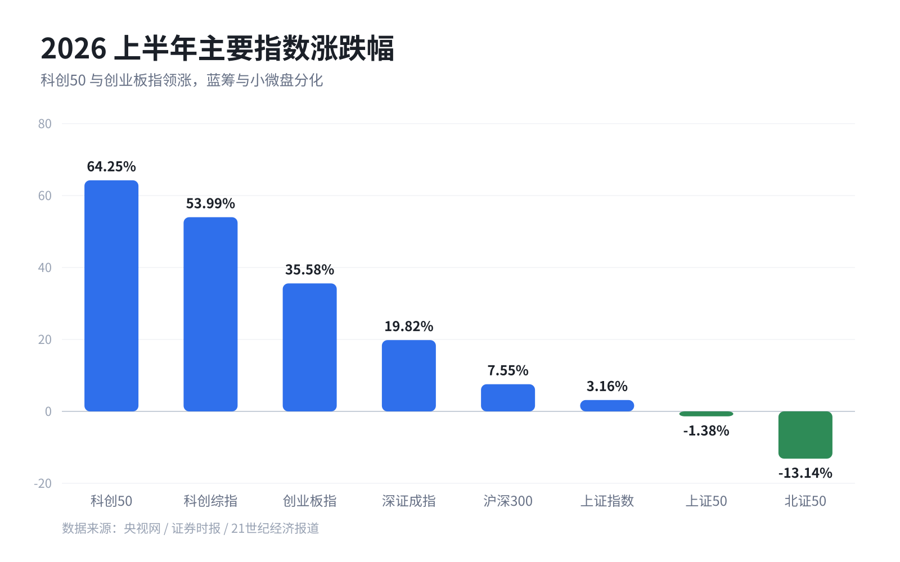
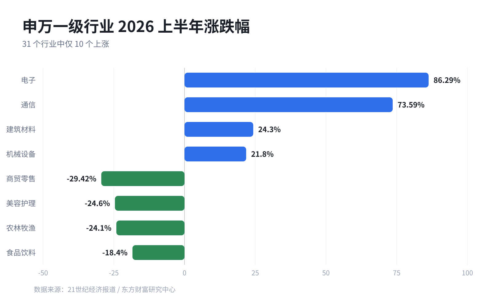

# 资料搜集员 · dsh-agent-researcher

> 一个装在 [DeepSeek Harness](https://github.com/deepseek-ai/deepseek-harness) 里的**中文研究助理 Agent**：联网检索、交叉核实，输出带来源链接和**多风格图表**的中文调研报告。
>
> A custom DeepSeek Harness **agent preset** for Chinese web research: searches, verifies, and writes a cited report with built-in multi-style charts.

它是一个真正的 Agent 定义（agent preset），不是一段临时提示词：有自己的中文人设、工作流程和检索类工具集，装好后会出现在 Harness 的设置页和新任务选择器里，随用随选。

## ✨ 特性

- **检索型工具链**：联网搜索、打开网页读原文、读写工作区文件、技能、待办清单、澄清提问、报告文件交付、长会话自动压缩
- **9 种图表样式**：内置 `write_chart` 工具，给数据就能生成柱状 / 条形 / 折线 / 面积 / 环形 / 堆叠 / 瀑布 / KPI 卡 / 散点 **SVG**，统一处理中文字体、坐标轴、图例、数值标注和来源脚注，不再手写 SVG（v1.1+）
- **有纪律的工作流程**：多角度检索 → 打开原文核实 → 交叉核对 → 带 `[编号]` 引用与完整来源清单；绝不编造链接、数字和引文
- **默认交付**：报告写入工作区 `reports/主题-YYYYMMDD.md`，并在对话里以文件卡片交付
- **安全边界**：**不挂载 shell，不执行命令、不改代码**；只读写当前会话工作区里的报告类文件
- **可自由改造**：人设和工具都在 `cordis.patch.yml` 里，改 YAML 就能增删工具、换人设

## 🚀 安装

仓库根目录本身就是一个 DeepSeek Harness 组合包（`package.json` 中的 `dsh.bundle.patch` 指向 `cordis.patch.yml`），所以支持多种安装方式。**只选一种**。

### 方式一：插件页从 Git 地址安装（推荐）

DeepSeek Harness → 侧栏 **插件** → **添加插件** → 填入：

```
github:lausinghao-collab/dsh-agent-researcher
```

或完整地址 `https://github.com/lausinghao-collab/dsh-agent-researcher`。安装完成后点 **立即启用**。

> 插件管理器会对 GitHub 仓库做一次连通性检查；如果本机访问 GitHub 不稳定，改用方式二或三。

### 方式二：本地目录 / 压缩包安装

```bash
git clone https://github.com/lausinghao-collab/dsh-agent-researcher.git
# 或者：下载本仓库 ZIP 并解压
```

然后 插件 → 添加插件 → 填**本仓库根目录的绝对路径**（例如 `D:\code\dsh-agent-researcher`），安装并启用。

### 方式三：手动安装（不用插件页）

把 [`install/preset.patch.yml`](install/preset.patch.yml) 追加到你的 profile 补丁文件末尾：

| 系统 | 文件 |
|---|---|
| Windows（桌面版） | `C:\Users\<用户名>\.dsh\profiles\desktop\cordis.patch.yml` |
| macOS / Linux | `~/.dsh/profiles/<profile>/cordis.patch.yml`（桌面版一般是 `desktop`，Web 版可能是 `web`） |

Windows 也可以直接跑脚本（自动备份、重复运行不重复装、打印回滚命令）：

```powershell
powershell -NoProfile -ExecutionPolicy Bypass -File ".\install\install.ps1"
```

### 方式四：不用 DeepSeek Harness

把 [`portable/system-prompt.md`](portable/system-prompt.md) 里的提示词粘贴到任意 AI 平台的「自定义指令 / 系统提示词 / 项目说明」（ChatGPT、Claude、DeepSeek、Kimi、豆包等）。没有联网工具的平台会先声明无法实时核实，仅基于你提供的资料作答。

## ✅ 验证

打开 **设置 → 通用 → Agent 预设**（或新建任务时的模式选择），应该能看到：

> **资料搜集员** · 联网检索、交叉核实，输出带来源链接的中文调研报告

看不到时：先刷新页面（Ctrl+R），仍没有就重启一次 Harness（部分 profile 的配置只在启动时应用）。

## 💬 使用示例

新建任务 → 选择「资料搜集员」→ 直接给题目：

- 「帮我调研 2026 年国内固态电池的量产进展，输出带来源的报告」
- 「对比国产三家大模型 API 的定价和上下文长度，做成表格」
- 「整理这三份本地 PDF 的核心结论，注明出处」（把文件放进工作区即可）

## 📊 图表样式（v1.1+）

Agent 内置了 `write_chart` 工具，把结构化数据渲染成独立 SVG——不用你写代码，也不用模型手写 SVG：

| 样式 | `type` | 适合场景 |
|---|---|---|
| 柱状图 | `bar` | 同量纲分类比较（指数涨跌幅、行业对比） |
| 条形图 | `hbar` | 分类多 / 名称长的排行榜 |
| 折线图 | `line` | 时间趋势、多系列对比 |
| 面积图 | `area` | 趋势与累计量 |
| 环形图 | `donut` | 占比结构 |
| 堆叠柱 | `stacked` | 多系列构成 |
| 瀑布图 | `waterfall` | 增量与贡献拆解 |
| KPI 卡 | `kpi` | 2–6 个关键数字 |
| 散点图 | `scatter` | 两个数值变量的相关性 |

使用方式就是自然语言：

> 「把上面的数据画成柱状图，深色主题、红色系、标注数据来源」

产物是**独立 SVG**（矢量、可缩放、可打印），默认写到 `reports/assets/`，报告里以 Markdown 图片引用：GitHub、文档预览、浏览器都能直接打开。支持浅色/深色主题、自定义配色、单位、副标题、右上角注释和来源脚注。

下面几张图都是这个工具直接生成的：





## 🖼 示例产出

这是用它真实跑出来的一份报告：**上证指数 2026 年上半年上涨 3.16%** —— 从检索、核实到成图、成文、附来源清单。


- [完整示例报告（Markdown）](examples/sse-2026h1-report.md)

## 🛠 自定义

- **改人设 / 工作流程**：编辑 `cordis.patch.yml` 中 `persona.prefix` 的文字
- **换工具**：增删 `plugins` 下的条目，例如
  - 加 `- id: tool-bash` + `name: "@deepseek-ai/dsh-tool-bash"` → 允许执行命令
  - 删掉 `tool-fs` → 禁止写文件
- 改完保存即生效（Harness 会热加载 profile 配置）；**新开**任务使用新版本，已开着的任务保持原组合
- 如果改用 Git / 本地目录方式安装，修改后重新安装或直接改 profile 里的对应行

## 🗑 卸载

- **插件页安装**：插件页找到 `dsh-agent-researcher` → 卸载
- **手动安装**：用 `install.ps1` 打印的恢复命令，或把备份文件复制回 `cordis.patch.yml`
- 已创建的任务不受影响

## 🔐 兼容性与安全边界

- **测试版本**：DeepSeek Harness `0.2.1-rc.2`（2026-10），v1.1.0 的 `write_chart` 工具在该版本上验证通过。版本差异较大时如果出现「加载失败的预设」卡片，属于预期——把 `cordis.patch.yml` 发给 Harness 里的 Agent 适配，或参照你的版本修改插件行
- **图表工具**：仅通过组合包方式安装时可用（它随包提供 `lib/index.js` / `lib/charts.js`）；手动安装方式没有安装该插件，agent 会改为手写 SVG
- **不执行命令、不改代码**：preset 不挂载 shell 工具
- **文件访问范围**：当前会话工作区（用于读写 `reports/` 下的报告）；不会主动碰其他目录
- **网络**：联网检索/抓取使用 Harness 自带的搜索能力
- **无遥测**：本仓库不包含任何数据收集代码；所有配置都在你本机的 `~/.dsh/profiles/` 下

## 📁 仓库结构

```
.
├── cordis.patch.yml        # 组合包 patch：声明「资料搜集员」agent preset（含 write_chart 行）
├── lib/
│   ├── index.js            # write_chart 工具插件（注册工具、写文件）
│   └── charts.js           # 纯函数 SVG 渲染器（9 种图表样式，无第三方依赖）
├── package.json            # 组合包清单（dsh.bundle.patch 指向上面）
├── test/
│   └── charts.test.mjs     # 图表渲染器单元测试（node --test）
├── install/
│   ├── preset.patch.yml    #  手动安装用的预设声明片段（不含图表插件）
│   └── install.ps1         #  Windows 手动安装脚本（备份 + 追加 + 幂等）
├── portable/
│   └── system-prompt.md    #  不依赖 Harness 的通用系统提示词
├── docs/
│   └── for-harness-agent.md#  给 Harness 里的 Agent 的安装指令（不会装就把它发给 Agent）
├── examples/               #  示例产出（报告 + 配图 + 图表样例 SVG）
└── LICENSE                 #  MIT
```

## ❓ 常见问题

**Q：装好了但看不到卡片？** 刷新页面；仍没有就重启 Harness。

**Q：安装时 pnpm / 网络报错？** Git 安装需要访问 GitHub；改用方式二（本地目录）或方式三（手动），效果一样。

**Q：`preset-researcher` 重复了？** 同时用了多种安装方式。删掉其中一种的声明即可，保留一份。

**Q：能商用吗？** MIT 许可，可以；但这就是一个 YAML 配置包，请自行评估合规性，报告内容也自行核实。

## 🧾 更新日志

- **v1.1.0**（2026-10）：新增 `write_chart` 图表工具——9 种样式、浅色/深色主题、自定义配色、单位与来源脚注；人设加入图表使用规范；新增单元测试与 CI 校验。
- **v1.0.0**（2026-10）：首个版本。agent preset + 三种安装方式（Git / 本地目录 / 手动）+ 通用系统提示词。

## 📄 License

[MIT](LICENSE) © 2026 lausinghao-collab．欢迎 fork、改人设、换工具后分享回来。
